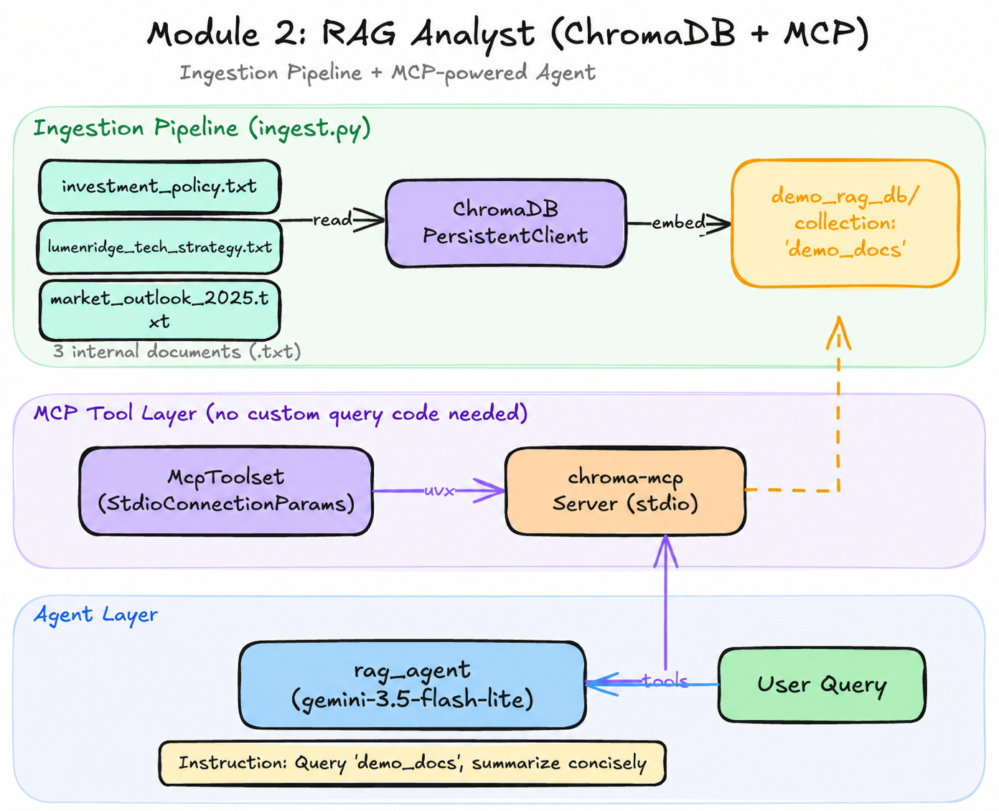

# Module 2 | Build and Benchmark a RAG Analyst

In Module 1, an ADK tool returned a known quote or portfolio calculation. In
Module 2, the analyst needs to find the passages that support its answer. You
will split the same documents three ways, compare what each search retrieves,
and give one of the indexes to an ADK analyst.

## The corpus and chunking strategies

The [corpus](corpus/) contains three simulated Lumenridge documents totaling
about 5,000 words. The investment policy, technology strategy, and market
outlook include rules, exceptions, and similar numbers with different meanings.
All three documents are fictional workshop material.

| Strategy | Where it splits |
| --- | --- |
| Fixed windows | Every 150 words, with no overlap. |
| Paragraphs | At blank lines. Each paragraph goes into the index separately. |
| Sections | At numbered headings. Longer sections are packed into groups of whole paragraphs up to 150 words. A paragraph over the limit falls back to fixed windows. |

Each run embeds the chunks with Chroma's local default embedding model and
creates a separate in-memory collection for each strategy.

## 1. Run the retrieval comparison

From the repository root with the workshop Python environment activated, run:

```bash
python -m module_02.rag_lab
```

The first run may download Chroma's local embedding model (about 80 MB). The
comparison uses no Gemini calls or Gemini API key.

The lab sends the same ten questions to each index. It takes the first 150 words
from up to 20 ranked chunks, clipping the last excerpt if necessary. All
strategies get the same word budget. A fixed number of chunks would give
long sections and short paragraphs different amounts of space.

The [answer key](evaluation.json) labels the exact source statements that
support each answer. A statement counts when all its words are present at their
original source positions in the retained excerpts. Adjacent fragments can
jointly cover a statement. The same words from another document cannot earn
credit. For example, an answer about the single-stock cap and its temporary
exception needs the cap, the time allowance, and the approving officer. If the
retrieved context covers two of those, the score is `2/3`. The final row counts
how many questions had all required evidence. This score measures retrieval
coverage. Check answer accuracy in the analyst step.

## 2. Explain two misses

```bash
python -m module_02.rag_lab --inspect risk-limits
python -m module_02.rag_lab --inspect crypto-ratings
```

Read the returned passages and find where each rule or qualifier appears.
Consider what the model could infer from the excerpts alone. The report
includes filenames and source line ranges so you can check the surrounding
text.

In the pilot with Chroma 1.5.9, fixed windows fully supported 6 of 10 questions.
Paragraphs and sections each supported 9, with different misses.

| Question | Fixed windows | Paragraphs | Sections |
| --- | ---: | ---: | ---: |
| Volatility ceiling and speculative-tech stop-loss | 1/2 | 1/2 | 2/2 |
| Crypto ratings for two types of portfolio | 1/2 | 2/2 | 1/2 |

- For the **risk limits**, the section chunk kept the volatility limit and the
  complete stop-loss rule together. The top fixed window ended with “15% below
  the”, leaving out what the trigger is measured from.
- For the **crypto ratings**, two short paragraphs fit both ratings into the
  budget. The sections configuration spent part of that budget on liquidity
  commentary and only fit one rating.

## 3. Change one setting and rerun

```bash
python -m module_02.rag_lab --window-words 100
```

In the pilot, 100-word fixed windows still fully supported 6 of 10 questions.
They recovered the single-stock cap and exception but lost evidence for the
tech investment screen and economic outlook. Inspect `cap-exception` or
`tech-screen` with both window sizes and explain the change. You can also use
`--budget 450` to see how more context changes the comparison. Choose a
configuration for this corpus and cite a question that influenced your choice.

## 4. Try the chosen index with ADK

The analyst makes one search using the same context budget as the comparison. It
prints the actual tool excerpts and then answers with references such as
`[S1]`, which map to filenames and source lines. This step uses Gemini and
loads `GOOGLE_API_KEY` from the repository's `.env.local`.

```bash
python -m module_02.rag_lab --strategy sections \
  --ask 'What are the portfolio volatility ceiling and the required stop-loss for a speculative technology position?'
```

Compare the agent's answer with the excerpts. Try the same question on another
index and look for any claim the tool output does not support.

## MCP and later modules

The [MCP agent](rag_agent/agent.py) used by Modules 3 and 4 still uses the short
sample documents and the bundled `demo_docs` collection. The architecture
diagram and [existing notebook](02_rag_agent.ipynb) describe that MCP example.
The Python lab builds its own in-memory indexes over the longer corpus.


